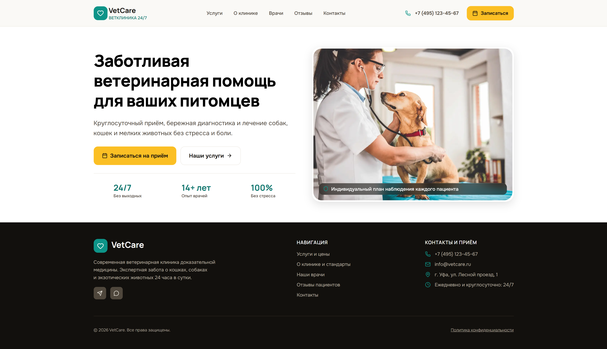

<div align="center">

# 🐾 VetCare

**Многостраничный адаптивный сайт ветеринарной клиники**

Twig + SCSS (BEM), сборка на Gulp, нативный JavaScript без библиотек.


**[Демо](https://sonnikd.github.io/vetcare-clinic/)** · **[Репозиторий](https://github.com/SonnikD/vetcare-clinic)**



</div>

## О проекте

Учебный проект: шесть страниц (главная, услуги, о клинике, врачи, отзывы, контакты и запись), собранных из переиспользуемых Twig-компонентов с единой системой дизайн-токенов.

- **Каталог услуг** с фильтром по категориям и модальным окном «Подробнее».
- **Форма записи** на странице контактов и в модальном окне на остальных страницах.
- **Адаптив** для десктопа, планшета (до 1024px) и мобильных (до 640px), мобильное меню.

## Стек

| Область         | Технологии                                                        |
| --------------- | ----------------------------------------------------------------- |
| Разметка        | HTML5, Twig                                                       |
| Стили           | SCSS, BEM, Flexbox, Grid                                          |
| Скрипты         | JavaScript (ES-модули)                                            |
| Сборка          | Gulp 5, gulp-twig, gulp-sass, PostCSS + Autoprefixer, BrowserSync |
| Шрифты, графика | Manrope, Onest (Google Fonts), WebP                               |

## Быстрый старт

Нужен [Node.js](https://nodejs.org/) (LTS).

```bash
git clone https://github.com/SonnikD/vetcare-clinic.git
cd vetcare-clinic
npm install
npm run dev      # http://localhost:3000 — сервер с автоперезагрузкой
npm run build    # разовая сборка в dist
```

> Скрипты подключены как ES-модули, поэтому `dist/index.html` нельзя открыть двойным кликом (`file://`). Используйте `npm run dev` или любой локальный сервер.

## Структура

```
src/
├── templates/   # layouts/, components/, pages/
├── scss/        # base/, components/, pages/, main.scss
├── js/          # modules/ (burger-menu, modal, services-filter), main.js
└── img/         # изображения и favicon
```

## Как это устроено

**Twig.** Общий каркас в `layouts/base.twig`, страницы переопределяют блоки `title`, `page`, `modal`. Компоненты принимают параметры, например кнопка сама выбирает тег (`<a>` при наличии `href`, иначе `<button>`):

```twig

```

Оболочка модального окна универсальна: содержимое подставляется через ``, поэтому одна и та же модалка работает для формы записи и для карточек услуг.

**SCSS.** BEM, один блок на файл. Блок не стилизует внутренности чужого блока: вариации задаются модификаторами (`button--large`). Адаптив пишется рядом с компонентом через миксин `respond`. Повторяющиеся паттерны вынесены в миксины: `grid-card`, `section-spacing`, `card`, `overlay-badge`, `icon-box`.

**Дизайн-токены.** Цвета в два уровня: примитивы и семантика. Отступы берутся из шкалы `$space-xs … $space-3xl`.

**JavaScript.** Нативные модули, связь с разметкой через `data-`-атрибуты: `data-modal-open` открывает нативный `<dialog>` с тем же `id`, `data-filter` и `data-tag` связывают фильтр и карточки.

## Доступность

Семантическая разметка, `aria-expanded` у меню, `aria-pressed` у фильтров, `aria-label` у навигаций и диалогов, видимый `:focus-visible`, плавная прокрутка отключается при `prefers-reduced-motion`.

## Планы по улучшению

**Сделано:**

- [x] Система дизайн-токенов и шкала отступов
- [x] Миксины вместо повторяющихся стилей
- [x] Изображения в WebP

**В планах:**

- [ ] Единый источник данных: вынести в `site.json` и подключить к шаблонам через `gulp-twig`
- [ ] Рабочая форма записи: валидация и отправка на сервер
- [ ] Сборка JS бандлером
- [ ] Новые разделы: FAQ с аккордеоном

## Автор

**Sofya Kozlova**: [GitHub](https://github.com/SonnikD) · [Telegram](https://t.me/sonnikd) · sonnikdkozlova@gmail.com
